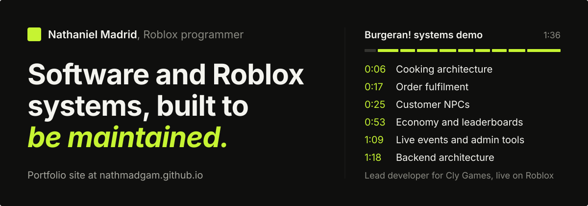

<p align="center">
  <a href="https://nathmadgam.github.io/"></a>
</p>

# Nathaniel Madrid, Roblox programmer portfolio

The source for <https://nathmadgam.github.io/>, the portfolio of Nathaniel Madrid:
founder of DATAL Projects, lead developer of Burgeran! for Cly Games, a Roblox
and a Roblox programmer who builds gameplay, backend services, persistent data, and
interfaces in Luau.

Plain HTML, CSS, and ES modules. No framework, no build step, no dependencies.

**[Open the site](https://nathmadgam.github.io/)** · [Start a project](https://datalprojects.com/contact) · [Cynex Services on Discord](https://discord.gg/Pnjjkc6FHY)

<p align="center">
  <a href="https://nathmadgam.github.io/"></a>
</p>

## What the page shows

The reader is a Roblox studio lead or game owner deciding whether to hire a programmer.
The page is a ship log: the left column holds who I am, the offer and the facts, then a
sticky index of the log; the right column is the log itself, one entry per kind of work
on a single spine, live work first, then archived.

1. **Burgeran!** Live on Roblox, with its chaptered systems demo (each chapter in "What
   I built" jumps the recording).
2. **Live games**, **businesses**, **system demos** (six, filterable),
   **studios and communities**, **client reviews**, **how I work** and the **contract**.
3. **Volunteering.** One small entry: I volunteer with BetterGov.ph. The community
   portals I help with are folded inside it, with a note that they are community-run
   and not official government websites.
4. **Contact.** Start a project through DATAL Projects, plus direct channels.

The spine fills with lime down to the reading position as the page scrolls, each
entry's dot lights once it is reached, and the index marks the entry in view.

## Design rules

The look follows the dark mode of [datalprojects.com](https://datalprojects.com), the
company site, so the portfolio and DATAL Projects read as one family. Written down so
changes stay deliberate.

**Colour.** A warm near-black canvas `#0f0f0e`, cards one step up at `#1a1a18`, 1px
borders `#33332f`, and one volt lime accent `#c6f432` (dark `#141414` text on it) for
primary buttons, the spine, reached dots, stars and live marks. Body text is
`#f4f4ef`, secondary `#a6a69e`. The light theme mirrors DATAL light: white canvas and
near-black `#1d1d1f` buttons. There are no colour washes or glows; the only pattern is the
dotted strip at each window edge. The checked WCAG contrast table sits
at the top of `styles.css`; add a row for any new text pair.

**Type.** Overpass for headings (600, tight tracking) and Inter for everything else,
the same pair DATAL uses. Labels are short, sentence case and used only to name a group.

**Surfaces.** Cards are flat: a 1px border on the raised surface, no shadows or blur.
Radii are 12px for buttons, tiles and media, 22px for cards, and a circle for the portrait. Lists of links sit in one bordered card with divided
rows and 36px icon tiles.

**Wide screens.** The page widens with the window up to about 1900px, and above
1700px the whole page scales up a step, so 1920 and 2560 screens are filled instead
of showing a small column in the middle.

**Numbers.** Numbers appear only where they carry information: demo timestamps and
the process steps, whose order matters.

**Motion.** One reveal for everything: a short fade and 16px rise with a small
stagger, on a soft ease with no overshoot. Nothing scales on hover. Reveals start just before
an element scrolls into view, so content is settled by the time it is read. The
process line follows scroll position. With `prefers-reduced-motion` everything
renders in its final state.

## Theming

Light and dark palettes are both defined as CSS custom properties at the top of
`styles.css`. Dark is the default for every visitor. Light is applied from an
explicit `data-theme="light"` on the root element, set by the header toggle and
stored in `localStorage`. A small inline script in `index.html` applies the saved
theme before first paint so the other palette never flashes.

Only the colour tokens change between themes. Nothing else in the stylesheet is
theme-aware, so a new component picks up dark mode automatically as long as it
uses the tokens.

## Structure

```
index.html             markup, metadata, and the inline SVG icon sprite
assets/css/styles.css  design tokens and all component styles
assets/js/app.js       rendering and behaviour (ES module)
assets/js/data.js      project, venture, experience, capability, network, and review content
assets/posters/        video poster frames (960×540)
assets/cached-media/   Roblox, Discord, and venture images
assets/contract-pages/ contract page previews
assets/fallbacks/      SVG placeholders used if a bitmap fails to load
assets/readme/         images used by this README
images/                portrait, header mark, favicons, and the Cynex Services logo
videos/                project demo recordings
downloads/             the client agreement PDF
```

## Editing content

Content lives in `assets/js/data.js`. The BetterGov.ph portal links are plain HTML in
the volunteering entry of `index.html`. Adding a project means adding one entry
plus a poster image and an MP4; no other file needs to change. When a stylesheet
or script changes, bump its `?v=` query in `index.html` so returning visitors get
the new file.

## Local preview

`index.html` loads `app.js` as an ES module, so it needs to be served over HTTP
rather than opened from the filesystem. Any static server works, for example:

```bash
python -m http.server 8000
```

Then open <http://localhost:8000>.
