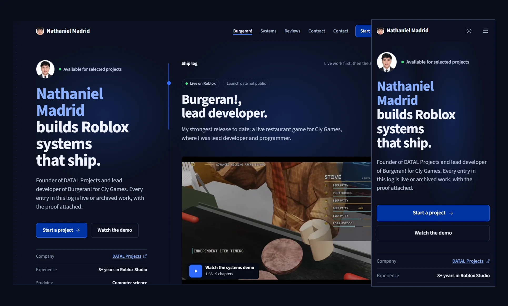

<p align="center">
  <a href="https://nathmadgam.github.io/"></a>
</p>

# Nathaniel Madrid, Roblox programmer portfolio

The source for <https://nathmadgam.github.io/>, the portfolio of Nathaniel Madrid:
founder of DATAL Projects, lead developer of Burgeran! for Cly Games, a Roblox
programmer who builds gameplay, backend services, persistent data, and interfaces in Luau,
and a BetterGov.ph volunteer who maintains nine community-run LGU portals.

Plain HTML, CSS, and ES modules. No framework, no build step, no dependencies.

**[Open the site](https://nathmadgam.github.io/)** · [Start a project](https://datalprojects.com/contact) · [Cynex Services on Discord](https://discord.gg/Pnjjkc6FHY)

<p align="center">
  <a href="https://nathmadgam.github.io/"></a>
</p>

## What the page shows

Two readers matter equally: a Roblox studio lead or game owner deciding whether to hire
a programmer, and a resident who can help keep their LGU portal correct. The page runs
in two lanes:

1. **Statement.** One sentence naming both kinds of work, with two equal actions:
   "Start a project" (goes straight to <https://datalprojects.com/contact>) and
   "Help a local portal".
2. **LGU portals.** The nine community-run portals on the
   [BetterLGU directory](https://lgu.bettergov.ph), as a Philippines map with numbered
   pins and a matching north-to-south list. Pointing at a pin or row lights the other;
   tapping a pin selects it. The portals are community-run and not official government
   websites, and the page says so.
3. **Send a local fact.** Councilor names, service guides, office phone numbers and
   hours, and official Facebook pages. The form builds a pre-filled GitHub issue on that
   portal's repository, or the same text as an email. Facts without a public source stay
   as placeholders.
4. **Developer lane.** Burgeran! with its chaptered systems demo (each chapter in "What
   I built" jumps the recording), ventures, six recorded system demos, published games,
   collaborations, capabilities and process, client feedback, and the client agreement.
5. **Contact.** One path per lane, plus direct channels.

## Design rules

Written down so changes stay deliberate instead of drifting back to generic
defaults (gradients, glass, card grids, the same fade on everything).

**Colour.** BetterGov blue on navy, laid out like datalprojects.com. Brand blue
`#0032A0` fills buttons (white text, with a `#2F6BFF` edge on dark; the same
blue tints the glow), and `#8AB0FF` is accent text and the lane marks on dark. The ground is
`#0b1020` with cards `#10172b`. Blue marks the developer lane; ember `#fc9053`
marks the civic lane. The only gradients are the soft glow behind the opening and the
dotted grid in the page margins. The checked WCAG contrast table sits at the top of
`styles.css`; add a row for any new text pair.

**Type.** One family, Source Sans 3 (Roblox ships it as `Enum.Font.SourceSans`).
Hierarchy comes from size, weight, italic and colour. No uppercase tracked
labels; labels are short, sentence case and used only to name a group.

**Surfaces.** No elevation shadows or blur. Content is separated by spacing and 1px
rules; the contribution form is the one card. Radii are 8px, 14px for cards.

**Numbers.** Numbers appear only where they carry information: the process steps,
whose order matters, and the portal list, whose numbers key the map pins.

**Motion.** Each content type has its own reveal (see the Motion block in
`styles.css`), on a long, soft ease with no overshoot. Reveals start just before
an element scrolls into view, so content is settled by the time it is read. The
process line follows scroll position. With `prefers-reduced-motion` everything
renders in its final state.

## Theming

Light and dark palettes are both defined as CSS custom properties at the top of
`styles.css`. Dark is the default for every visitor. Light is applied from an
explicit `data-theme="light"` on the root element, set by the header toggle and
stored in `localStorage`. A small inline script in `index.html` applies the saved
theme before first paint so the other palette never flashes.

Only the colour tokens change between themes. Nothing else in the stylesheet is
theme-aware, so a new component picks up dark mode automatically as long as it
uses the tokens.

## Structure

```
index.html             markup, metadata, and the inline SVG icon sprite
assets/css/styles.css  design tokens and all component styles
assets/js/app.js       rendering and behaviour (ES module)
assets/js/data.js      LGU portals, contribution topics, and project, venture, experience,
                       capability, network, and review content
assets/img/            the Philippines outline used as the map mask (Natural Earth)
assets/posters/        video poster frames (960×540)
assets/cached-media/   Roblox, Discord, and venture images
assets/contract-pages/ contract page previews
assets/fallbacks/      SVG placeholders used if a bitmap fails to load
assets/readme/         images used by this README
images/                portrait, header mark, favicons, and the Cynex Services logo
videos/                project demo recordings
downloads/             the client agreement PDF
```

## Editing content

Content lives in `assets/js/data.js`. Each LGU portal is one entry with its repo name
and map position in percent; `dx`/`dy` draw a crowded pin a short way off with a leader
line. Adding a project means adding one entry
plus a poster image and an MP4; no other file needs to change. When a stylesheet
or script changes, bump its `?v=` query in `index.html` so returning visitors get
the new file.

## Local preview

`index.html` loads `app.js` as an ES module, so it needs to be served over HTTP
rather than opened from the filesystem. Any static server works, for example:

```bash
python -m http.server 8000
```

Then open <http://localhost:8000>.
