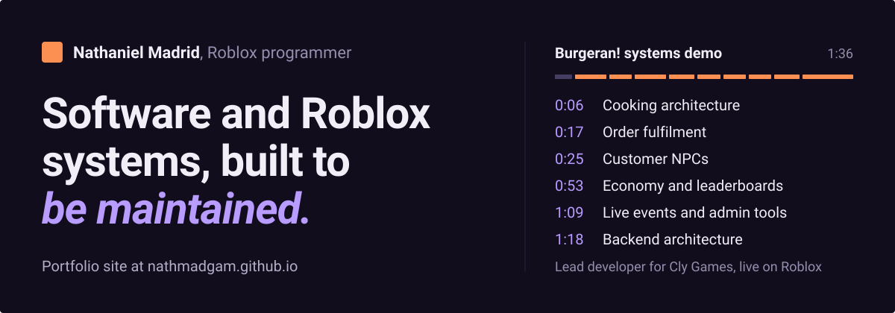
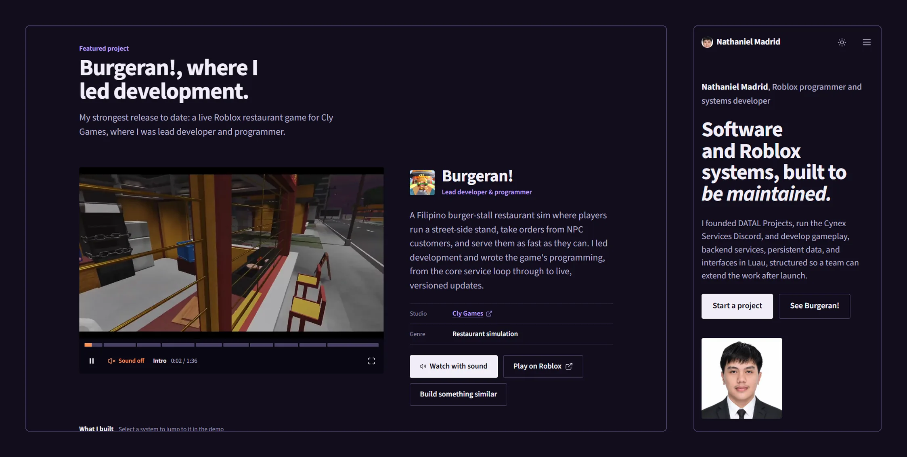
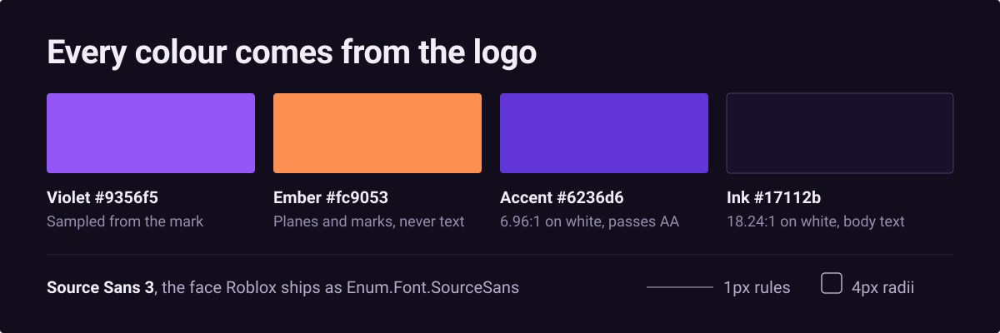

<p align="center">
  <a href="https://nathmadgam.github.io/"></a>
</p>

# Nathaniel Madrid, Roblox programmer portfolio

The source for <https://nathmadgam.github.io/>, the portfolio of Nathaniel Madrid:
founder of DATAL Projects, lead developer of Burgeran! for Cly Games, and a Roblox
programmer who builds gameplay, backend services, persistent data, and interfaces in Luau.

Plain HTML, CSS, and ES modules. No framework, no build step, no dependencies.

**[Open the site](https://nathmadgam.github.io/)** · [Start a project](https://datalprojects.com/contact) · [Cynex Services on Discord](https://discord.gg/Pnjjkc6FHY)

<p align="center">
  <a href="https://nathmadgam.github.io/#featured"></a>
</p>

## What the page shows

The reader is a Roblox studio lead or game owner deciding whether to hire a programmer.
They came to see proof of shipped work, then get in touch, so the page runs in that order:

1. **Statement and Burgeran!** The opening line, then a live game with a chaptered
   systems demo. Each chapter in "What I built" jumps the recording to that system.
2. **Ventures and work.** DATAL Projects, Cynex Services, Tenasa Games, and six recorded
   system demos you can filter and play.
3. **Track record.** Live experiences, freelance collaborations, capabilities, the four-step
   process, and client feedback.
4. **Getting started.** The client agreement viewer and contact.

"Start a project" is the easiest action on the page and goes straight to
<https://datalprojects.com/contact>.

## Design rules

<p align="center">
  
</p>

Written down so changes stay deliberate instead of drifting back to generic
defaults (gradients, glass, card grids, the same fade on everything).

**Colour.** Every colour comes from the Cynex mark (`images/cynex-services.png`):
violet `#9356f5`, ember `#fc9053`, and the white glyph, plus tints and shades of
the violet. Colours are flat planes; nothing is a gradient. The checked WCAG
contrast table sits at the top of `styles.css`; add a row for any new text pair.

**Type.** One family, Source Sans 3 (Roblox ships it as `Enum.Font.SourceSans`).
Hierarchy comes from size, weight, italic and colour. No uppercase tracked
labels; labels are short, sentence case and used only to name a group.

**Surfaces.** No card shells, elevation shadows or blur. Content is separated by
spacing and 1px rules. Radii stay at 4px.

**Numbers.** Only the process steps are numbered, because their order matters.

**Motion.** Each content type has its own reveal (see the Motion block in
`styles.css`), on a long, soft ease with no overshoot. Reveals start just before
an element scrolls into view, so content is settled by the time it is read. The
process line follows scroll position. With `prefers-reduced-motion` everything
renders in its final state.

## Theming

Light and dark palettes are both defined as CSS custom properties at the top of
`styles.css`. Dark is applied either from `prefers-color-scheme` or from an
explicit `data-theme="dark"` on the root element, set by the header toggle and
stored in `localStorage`. A small inline script in `index.html` applies the saved
theme before first paint so the other palette never flashes.

Only the colour tokens change between themes. Nothing else in the stylesheet is
theme-aware, so a new component picks up dark mode automatically as long as it
uses the tokens.

## Structure

```
index.html             markup, metadata, and the inline SVG icon sprite
assets/css/styles.css  design tokens and all component styles
assets/js/app.js       rendering and behaviour (ES module)
assets/js/data.js      project, venture, experience, capability, network, and review content
assets/posters/        video poster frames (960×540)
assets/cached-media/   Roblox, Discord, and venture images
assets/contract-pages/ contract page previews
assets/fallbacks/      SVG placeholders used if a bitmap fails to load
assets/readme/         images used by this README
images/                portrait, header mark, favicons, and the Cynex Services logo
videos/                project demo recordings
downloads/             the client agreement PDF
```

## Editing content

Content lives in `assets/js/data.js`. Adding a project means adding one entry
plus a poster image and an MP4; no other file needs to change. When a stylesheet
or script changes, bump its `?v=` query in `index.html` so returning visitors get
the new file.

## Local preview

`index.html` loads `app.js` as an ES module, so it needs to be served over HTTP
rather than opened from the filesystem. Any static server works, for example:

```bash
python -m http.server 8000
```

Then open <http://localhost:8000>.
